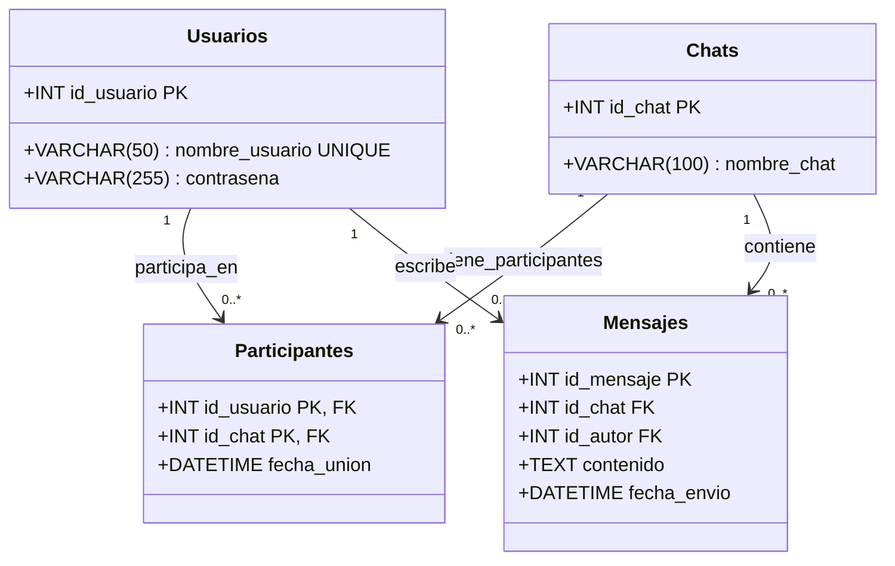
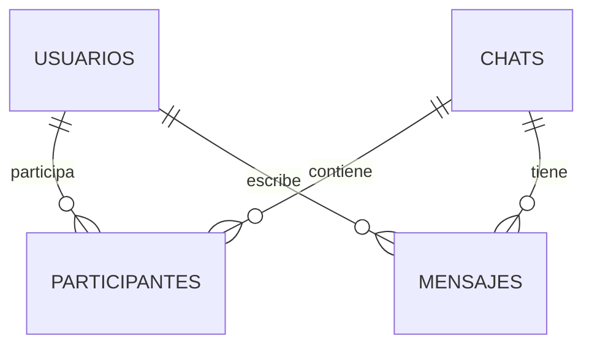

# Ecosistema del repositorio

Este repositorio contiene el ecosistema completo del chat: dos clientes TUI (Python y C), servidor intermediario en Rust, backend Java como capa de aplicación y MySQL como base de datos.

```
Cliente Python ──┐
                 ├──TCP:6969──► Servidor Rust ──TCP:9090──► Backend Java ──JDBC──► MySQL
Cliente C      ──┘
```

Ver el fichero [INSTALL](INSTALL) para instrucciones de instalación, compilación y ejecución.

---

# Cliente Python (TUI)

## Descripción general

Aplicación de mensajería de terminal (TUI) escrita en Python 3 con `curses`. Se conecta al servidor Rust por TCP, envía peticiones JSON y recibe respuestas y mensajes push en tiempo real. Los mensajes se guardan localmente por usuario para permitir historial offline y sincronización incremental al iniciar sesión.

## Ejecución

```bash
cd client-python
python3 main.py
```

## Módulos

| Módulo | Responsabilidad |
|---|---|
| `main.py` | Controlador principal; máquina de estados AUTH → LIVE → EXIT |
| `tui.py` | Capa de presentación curses (lista de chats, mensajes, entrada) |
| `api_client.py` | Abstracción sobre el protocolo; un método por operación |
| `network.py` | Cliente TCP con hilo receptor en segundo plano y cola interna |
| `protocol.py` | Constructores de mensajes JSON y parser de respuestas |
| `app_state.py` | Modelos de estado: enums de pantalla y sesión en memoria |
| `persistence.py` | Lectura/escritura de conversaciones en `./chats/<usuario>/` |
| `images.py` | Encode/decode de imágenes; gestión de UUIDs locales y refs |
| `config.py` | Lectura de `config.txt` |

## Funcionalidades

- Login y registro de usuario con contraseña oculta (Tab para mostrar/ocultar)
- Navegación entre chats con ↑/↓
- Envío de mensajes con ENTER
- Creación de chats de grupo con la tecla `n`
- Sincronización incremental al iniciar sesión (`LOADMESSAGEDELTA`)
- Indicador `◆` verde en chats con mensajes no leídos recibidos por push
- Historial local persistente en `./chats/<usuario>/` con sincronización incremental vía `last_sync.txt`
- Mensajes fallidos marcados con `[FALLIDO]` en rojo
- Envío de imágenes: escribe la ruta del fichero como mensaje (`.jpg`, `.jpeg`, `.png`, `.gif`, `.webp`)
- Cada cliente genera un UUID local para cada imagen recibida o enviada; el UUID no viaja por red
- Imágenes guardadas en `./chats/<usuario>/images/` y visualizadas como `[imagen: uuid.ext]`
- Selector de imágenes con la tecla `o`; se abre con `xdg-open` (Linux) o `open` (macOS)

## Base de datos

La base de datos se define en [shared/database.sql](shared/database.sql) y se compone de cuatro tablas principales: Usuarios, Chats, Participantes y Mensajes.

### Diagrama UML (modelo relacional)



# Cliente C (TUI ncurses)

## Descripción general

Cliente de mensajería de terminal escrito en C con `ncurses`. Implementa el mismo protocolo JSON + EOT que el cliente Python y se conecta al mismo servidor Rust.

La orientación del cliente C es diferente a la del Python: no pretende alcanzar el mismo conjunto de funcionalidades, sino ofrecer una alternativa de más bajo nivel, con menor consumo de recursos y sin dependencias de intérprete. El desarrollo futuro del cliente C iría ampliando sus capacidades progresivamente dentro de esa misma filosofía, sin converger necesariamente con la versión Python.

## Ejecución

```bash
cd client-c
./cli7
```

## Módulos

| Fichero | Responsabilidad |
|---|---|
| `main.c` | Controlador principal; máquina de estados AUTH → LIVE → EXIT |
| `tui.c/h` | Capa de presentación ncurses (lista de chats, mensajes, entrada) |
| `network.c/h` | Cliente TCP con hilo receptor en segundo plano y cola circular |
| `protocol.c/h` | Constructores de mensajes JSON y parsers mínimos |
| `app_state.c/h` | Sesión en memoria: chats y mensajes (arrays estáticos) |

## Funcionalidades implementadas

- Login y registro de usuario
- Navegación entre chats con ↑/↓
- Envío de mensajes de texto con ENTER
- Creación de chats de grupo con la tecla `n`
- Recepción de mensajes push en tiempo real
- Sincronización incremental al iniciar sesión (`load_message_delta`)

## No implementado

- Envío y recepción de imágenes
- Persistencia local entre sesiones (sin caché en disco)
- Indicador de mensajes no leídos
- Scroll en el historial de mensajes
- Ocultar/mostrar contraseña durante el login

# Backend Java 

## Descripcion general
Este backend en Java encapsula la lógica relacionada a la BBDD y expone una serie de llamadas predifinidas para que las use el servidor asociado. La persistencia se realiza sobre MySQL, manteniendo el estado de usuarios, chats y mensajes en una base de datos centralizada.

La arquitectura sigue la siguiente lógica: Controller -> Service -> Repository.


## Flujo request

### Controller

Recibe la peticion y hace la traduccion a formato interno. Para ello usa los DTO y, una vez terminado, pasa a llamar al servicio.

### Service

Realiza todo el código que puede estar relacionada a la peticion. Contrains, calculo de terceros parámetros, etc...
El mapping de resultado de la BBDD a los objetos internos.

### Repository

Una vez se ha preprocesado lo necesario el repository hace las peticiones necesarias a la BBDD.

## Peticiones TCP soportadas

El backend TCP espera mensajes con el formato:

`<NombrePeticion>{...json...}<0x04>`

Las peticiones actualmente soportadas por `TcpServerRunner` son:

- `AuthRequest` → valida credenciales (`CheckPasswordRequestDTO`)
- `AddUserRequest` → crea usuario (`AddUserRequestDTO`)
- `CreateChatRequest` → crea chat y participantes (`AddChatRequestDTO`)
- `SendMessageRequest` → guarda mensaje en un chat (`AddMessageRequestDTO`)
- `LOADMESSAGEDELTA` → recupera mensajes posteriores a una fecha (`LoadMessageDeltaRequestDTO`)
- `GETCHATMEMBERSREQUEST` → obtiene la lista de participantes de un chat


## Arquitectura de datos
- Base de datos centralizada en MySQL (InnoDB).
- Entidades principales: Usuarios, Chats, Participantes, Mensajes.




### checkPassword - Comprueba las credenciales del usuario

**Descripción**: Valida que el usuario existe y que la contraseña es correcta. Utiliza `CaesarCipher.matches()` para comparar la contraseña cifrada almacenada en la base de datos.

**Flujo de operación**:
1. Recibe el nombre de usuario y la contraseña
2. Consulta la tabla USUARIOS por nombre_usuario
3. Si el usuario existe: compara la contraseña cifrada con `CaesarCipher.matches(plain, stored)`
4. Retorna `authorized: true` si es correcto, `authorized: false` en caso contrario

**Tablas implicadas**: USUARIOS

**RequestDTO**: `CheckPasswordRequestDTO`
```json
{
  "username": "maria",
  "password": "secreto"
}
```

**ResponseDTO**: `CheckPasswordResponseDTO`
```json
{
  "authorized": true
}
```

---

### addUser - Añade un nuevo usuario a la base de datos

**Descripción**: Crea un nuevo usuario con su contraseña hasheada. Verifica primero que el nombre de usuario no existe para evitar duplicados.

**Flujo de operación**:
1. Recibe nombre de usuario y contraseña
2. Consulta la tabla USUARIOS para verificar que el nombre_usuario no existe
3. Si ya existe: retorna `processed: false`
4. Si no existe: 
   - Cifra la contraseña con `CaesarCipher.encrypt()`
   - Inserta nuevo registro en USUARIOS con nombre_usuario y contraseña hasheada
   - Retorna `processed: true`

**Tablas implicadas**: USUARIOS

**RequestDTO**: `AddUserRequestDTO`
```json
{
  "username": "jorge",
  "password": "atf28"
}
```

**ResponseDTO**: `AddUserResponseDTO`
```json
{
  "processed": true
}
```

---

### addChat - Crea un chat y añade participantes

**Descripción**: Crea un chat nuevo y vincula a los usuarios indicados como participantes iniciales.

**Flujo de operación**:
1. Recibe nombre de chat y lista de usuarios
2. Valida que `chatname` no esté vacío y que `usernames` tenga al menos un elemento
3. Verifica que no exista ya un chat con ese nombre
4. Elimina duplicados y usuarios vacíos de la lista de participantes
5. Comprueba que todos los usuarios existan en USUARIOS
6. Crea el chat en CHATS
7. Inserta un registro en PARTICIPANTES por cada usuario con `fecha_union = NOW()`
8. Retorna `processed: true` si todo va bien

**Tablas implicadas**: USUARIOS, CHATS, PARTICIPANTES

**RequestDTO**: `AddChatRequestDTO`
```json
{
  "chatname": "grupo-amigos",
  "usernames": ["jorge", "alicia", "maria"]
}
```

**ResponseDTO**: `AddChatResponseDTO`
```json
{
  "processed": true
}
```

---

### addMessage - Añade un nuevo mensaje al historial

**Descripción**: Añade un mensaje a un chat ya existente.

**Flujo de operación**:
1. Recibe `username`, `chatname`, `message` y `date`
2. Consulta USUARIOS para obtener id_usuario del emisor
3. Busca el chat por `chatname`
4. Si no existe el usuario o el chat: retorna `processed: false`
5. Inserta registro en MENSAJES con:
   - id_chat del chat encontrado
   - id_autor del usuario emisor
   - contenido con `message`
   - fecha_envio parseada desde `date`
6. Retorna `processed: true`

**Tablas implicadas**: USUARIOS, CHATS, MENSAJES

**Prerequisitos**: El usuario emisor y el chat deben existir.

**RequestDTO**: `AddMessageRequestDTO`
```json
{
  "username": "jorge",
  "chatname": "grupo-amigos",
  "message": "Que haces el viernes morena?",
  "date": "2026-05-04 10:30:00"
}
```

**ResponseDTO**: `AddMessageResponseDTO`
```json
{
  "processed": true
}
```

---

### loadConversations - Carga todas las conversaciones de un usuario

**Descripción**: Devuelve un listado de todas las conversaciones del usuario con todos sus mensajes, organizadas por nombre de usuario del otro participante.

**Flujo de operación**:
1. Recibe nombre de usuario
2. Consulta USUARIOS para obtener id_usuario
3. Si no existe: retorna conversaciones vacío
4. Consulta PARTICIPANTES para obtener todos los id_chat donde participa el usuario
5. Para cada chat encontrado:
   - Consulta MENSAJES para obtener todos los mensajes del chat (ordenados por fecha_envio ASC)
   - Para cada mensaje: obtiene el nombre del autor desde su id_autor
   - Agrupa los mensajes bajo la clave del nombre del chat
6. Retorna estructura Map<chatname, List<MessageDTO>> donde cada MessageDTO contiene:
   - chatname: nombre del chat
   - author: nombre del usuario que escribió el mensaje
   - contents: contenido del mensaje
   - sent: timestamp en formato "yyyy-MM-dd HH:mm:ss"

**Tablas implicadas**: USUARIOS, PARTICIPANTES, CHATS, MENSAJES

**RequestDTO**: `LoadConversationsRequestDTO`
```json
{
  "username": "alicia"
}
```

**ResponseDTO**: `LoadConversationsResponseDTO`
```json
{
  "conversations": {
    "bob": [
      {
        "chatname": "bob",
        "author": "alicia",
        "contents": "Hola, ¿cómo estás?",
        "sent": "2026-05-02 10:00:00"
      },
      {
        "chatname": "bob",
        "author": "bob",
        "contents": "Todo bien, ¿y tú?",
        "sent": "2026-05-02 10:05:00"
      }
    ],
    "charlie": [
      {
        "chatname": "charlie",
        "author": "charlie",
        "contents": "Has visto los nuevos cambios?",
        "sent": "2026-05-02 11:30:00"
      },
      {
        "chatname": "charlie",
        "author": "alicia",
        "contents": "Sí, acabo de revisar el repo.",
        "sent": "2026-05-02 11:32:00"
      }
    ]
  }
}
```


---

### loadMessageDelta - Carga mensajes nuevos desde una fecha

**Descripción**: Devuelve todos los mensajes de los chats del usuario que sean posteriores a la fecha indicada. Usado por el cliente al iniciar sesión para sincronización incremental.

**Flujo de operación**:
1. Recibe `username` y `since` (formato `yyyy-MM-dd HH:mm:ss`)
2. Obtiene todos los chats donde participa el usuario
3. Para cada chat: consulta MENSAJES donde `fecha_envio > since`
4. Devuelve el mapa de conversaciones con solo los mensajes nuevos

**Tablas implicadas**: USUARIOS, PARTICIPANTES, CHATS, MENSAJES

**RequestDTO**: `LoadMessageDeltaRequestDTO`
```json
{
  "username": "alicia",
  "since": "2026-05-01 00:00:00"
}
```

**ResponseDTO**:
```json
{
  "conversations": {
    "grupo-amigos": [
      {
        "chatname": "grupo-amigos",
        "author": "jorge",
        "contents": "Que haces el viernes?",
        "sent": "2026-05-02 10:30:00"
      }
    ]
  }
}
```

## Dependencias

El proyecto utiliza Maven como gestor de dependencias. Las siguientes librerías son esenciales:

| Dependencia | Versión | Propósito | Alcance |
|---|---|---|---|
| `spring-boot-starter-data-jpa` | 3.2.5 | Acceso a datos con JPA/Hibernate | compile |
| `mysql-connector-j` | (inherited) | Driver JDBC para MySQL | runtime |
| `org.projectlombok:lombok` | (inherited) | Generación automática de getters/setters | compile |
| `spring-boot-starter-test` | 3.2.5 | Testing (JUnit5, Mockito) | test |
| `com.fasterxml.jackson.core:jackson-databind` | (inherited via Spring Boot) | Serialización/deserialización JSON | compile |

### Configuración de Maven

Ejecutar los tests:
```bash
mvn test
```

Compilar el proyecto:
```bash
mvn clean compile
```

Construir el JAR:
```bash
mvn package
```

---

## Seguridad

Las contraseñas se cifran con `CaesarCipher`: desplazamiento fijo de 47 posiciones sobre el rango de caracteres ASCII imprimibles (32–126). La clase `CaesarCipher` en `shared/util/` expone `encrypt(plain)` y `matches(plain, encrypted)`, que son los únicos puntos de acceso a credenciales en el backend.
