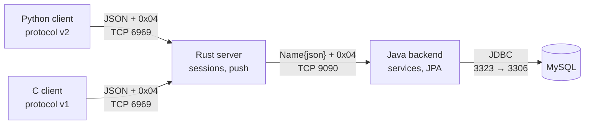

# Chat

A terminal chat made of four programs in four languages that talk through small, documented
protocols: two terminal clients (Python and C), a relay server in Rust and an application backend in Java
on top of MySQL.

[](../../actions/workflows/ci.yml)


## Table of contents

- [Overview](#overview)
- [Features](#features)
- [Architecture](#architecture)
- [Quick start](#quick-start)
- [Ports and configuration](#ports-and-configuration)
- [Protocol versions](#protocol-versions)
- [Project structure](#project-structure)
- [Testing](#testing)
- [Security notes](#security-notes)
- [Roadmap](#roadmap)
- [Authors](#authors)
- [License](#license)

## Overview

Each layer has one job and a protocol of its own:

| Layer | Language | Job |
|---|---|---|
| Client (full) | Python, `curses` | Complete interface: Unicode, images, local history |
| Client (simple) | C, `ncurses` | Minimal interface: plain ASCII text |
| Relay server | Rust | Sessions, login, push notifications, protocol versions |
| Backend | Java, Spring Data | Business rules and persistence |
| Database | MySQL 8 | Users, chats, memberships, messages |

It was written for a university course on distributed programming and then reworked into a tested,
documented project.

## Features

- Registration and login (passwords are hashed with BCrypt).
- Group chats; members that are online are notified of new chats and messages at once.
- History is synchronized incrementally (only what is newer than the last message a client has).
- **Two protocol versions** chosen by each client when it connects, so a simple client and a full one can
  share a chat: the simple one sees text only (images appear as `[image]`, non-ASCII characters as `?`).
- Images and any Unicode text in the Python client.
- Conversations and images are also kept locally by the Python client.

## Architecture



More detail, sequence diagrams and the data model are in [docs/ARCHITECTURE.md](docs/ARCHITECTURE.md);
the messages themselves are in [docs/PROTOCOL.md](docs/PROTOCOL.md).

## Quick start

Requirements: Docker, Java 17+, Maven, Rust (stable), Python 3.11+, GCC and `libncurses-dev` (for the C
client). The whole procedure is in [docs/INSTALL.md](docs/INSTALL.md).

```bash
make build         # backend jar, Rust server, C client
make up            # MySQL in Docker, published on host port 3323
```

Then, in three terminals:

```bash
make run-backend   # 1. the Java backend
make run-server    # 2. the Rust server
make run-client    # 3. the Python client (or: make run-client-c)
```

> **MySQL runs on port 3323, not on the default 3306**, so it never clashes with a MySQL you already have.
> To use another port: `CHAT_DB_PORT=3400 make up` and start the backend with
> `CHAT_DB_URL=jdbc:mysql://localhost:3400/chat_app`.

Keys in the clients: `↑`/`↓` change chat, `Enter` writes a message, `n` creates a chat, `q` quits, `Esc` cancels
what you are typing. In the Python client, writing the path of an image file sends the image and `o` opens it.

## Ports and configuration

Everything is configured with environment variables (see [`.env.example`](.env.example)) and has a default.

| What | Default | Variable |
|---|---|---|
| MySQL, published on the host | **3323** (container: 3306) | `CHAT_DB_PORT` |
| Backend → database | `jdbc:mysql://localhost:3323/chat_app` | `CHAT_DB_URL`, `CHAT_DB_USER`, `CHAT_DB_PASSWORD` |
| Rust server listens on | `127.0.0.1:6969` | `CHAT_SERVER_BIND`, `CHAT_SERVER_PORT` |
| Rust server → backend | `127.0.0.1:9090` | `CHAT_BACKEND_HOST`, `CHAT_BACKEND_PORT` |
| Clients → server | `127.0.0.1:6969` | `CHAT_SERVER_HOST`, `CHAT_SERVER_PORT` or `--host` / `--port` |

## Protocol versions

The first message of a connection is `{"action":"hello","version":N}`. Version 1 is for simple clients and
version 2 for full ones; the server keeps one implementation of what differs and shares the rest.

| | v1 (C client) | v2 (Python client) |
|---|---|---|
| Text sent | printable ASCII, up to 1000 characters | any text |
| Images | not understood (shown as `[image]`) | supported |
| Text received | non-ASCII characters shown as `?` | unchanged |
| Registration | one reply, already logged in | two replies: result, then login |

Names of users and chats are plain ASCII (letters, digits, `_`, `-`, `.`) in every version so that every
client can type and show them. Details: [docs/PROTOCOL.md](docs/PROTOCOL.md).

## Project structure

```
backend-java/     Spring Boot backend: domain, repositories, services, protocol, TCP server
server-rust/      relay server: protocol, versions, sessions (logic), server (sockets), backend client
client-python/    chat_client package: protocol, network, api, controller, curses screens
client-c/         simple client: json, protocol, session, network, ncurses interface
shared/           database schema (database.sql) and a data reset script
tests/e2e/        end-to-end tests of the whole system
docs/             architecture, protocol, installation
docker-compose.yml  MySQL for development and tests
```

## Testing

```bash
make test    # unit tests of the four components; no database needed
make e2e     # MySQL (Docker) + backend + server + clients, 8 scenarios
```

| Component | Tests |
|---|---|
| Java | 44 (services, protocol, TCP server, password hashing) |
| Rust | 60 (protocol, every request with a fake backend, real sockets) |
| Python | 110, 95% coverage (controller, network, curses screens with a fake terminal) |
| C | 165 checks, also run under AddressSanitizer and UBSan |
| End to end | 8 (registration, real-time chat, reconnection, images, simple + full client, shutdown) |

## Security notes

- Passwords are hashed with BCrypt before they are stored. While they travel (client → server → backend)
  they are plain text on connections that are not encrypted, see the next point.
- **The protocol is not encrypted.** The server therefore listens on `127.0.0.1` by default; set
  `CHAT_SERVER_BIND=0.0.0.0` only on a trusted network. TLS is on the [roadmap](ROADMAP.md).
- The author of a message is always the logged-in user of the connection, never a name sent by the client,
  and only members of a chat can write in it.
- The credentials in `docker-compose.yml` and `application.properties` are for local development only.

## Roadmap

See [ROADMAP.md](ROADMAP.md): end-to-end encryption, TLS, a third protocol version, and more.

## Authors

- Joaquín De Vicente Abad
- [Pablo Corzo](https://github.com/PabloCorzo)
- [Pilar Fernández Adillo](https://github.com/adillo8)

Built together as the final practical of *Programación Distribuida* (CEU San Pablo University), and
reworked afterwards.

## License

[MIT](LICENSE)
