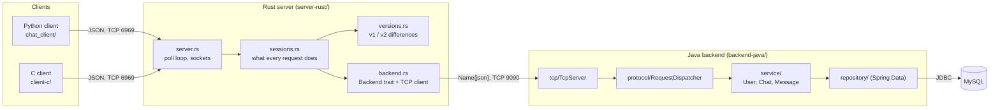
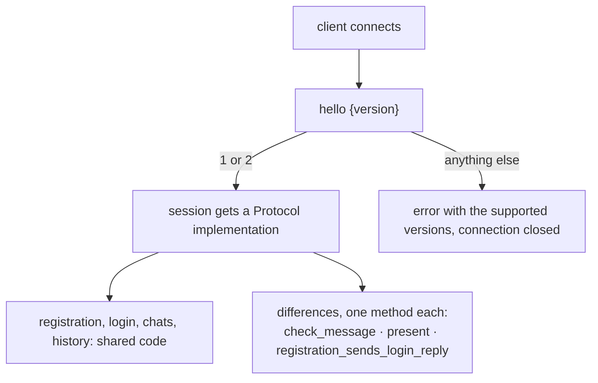
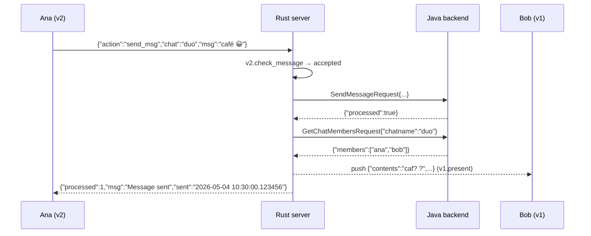
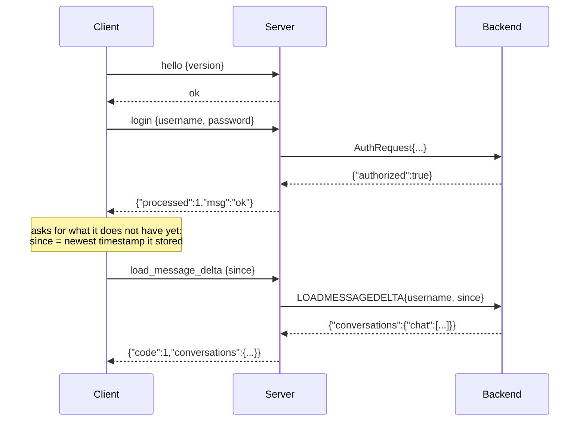
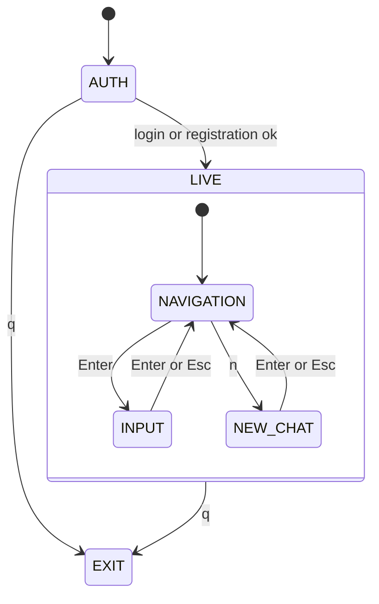

# Architecture

## Components

| Component | Responsibility | Why it is separate |
|---|---|---|
| Clients | Show the conversations and read what the user types | Two clients with different capabilities share one server |
| Rust server | Connections, login state, **push** to online users, protocol versions | Keeps long-lived connections; the backend can be request/response |
| Java backend | Business rules (who may write where), password hashing, persistence | The only part that knows the database |
| MySQL | Durable data | |

## The server is written for testing

`sessions.rs` contains the behaviour of every request and knows nothing about sockets or Java: it is
generic over a `Backend` trait and over a `Write`. The tests run the whole protocol against an in-memory
backend and in-memory connections; `server.rs` is a thin `poll(2)` loop that moves bytes in and out, and
wakes up every 100 ms so that a shutdown request is noticed at once.

## Protocol versions

`Protocol` is a trait whose default methods are the behaviour of the full version; `V1` overrides only what
differs. Adding a version is writing one `impl` and one line in `for_version`.

## A message from a full client to a simple one

The database keeps the original text; each recipient receives it as its protocol version presents it.

## Signing in and catching up

The cursor is a timestamp with **microsecond** precision: with whole seconds, a message sent in the same
second as the newest one a client already had would be lost.

## Client structure

The Python client keeps what happens (`controller.py`: sign in, synchronize, receive pushes, send, create
chats) apart from what is shown (`tui.py`, `app.py`), so the first is tested without a terminal.

## Backend layers

`tcp/TcpServer` frames UTF-8 messages and answers one at a time; `protocol/RequestDispatcher` routes
`RequestName{json}` to a handler and turns every failure into a valid JSON error; handlers call the
services (`UserService`, `ChatService`, `MessageService`), which use four Spring Data repositories. Handlers
are declared in one place (`ProtocolConfig`).

## Data model

```mermaid
erDiagram
    users ||--o{ chat_members : "belongs to"
    chats ||--o{ chat_members : "has"
    chats ||--o{ messages : contains
    users ||--o{ messages : writes
    users {
        bigint id PK
        varchar username UK
        varchar password_hash "BCrypt"
    }
    chats {
        bigint id PK
        varchar name UK
    }
    chat_members {
        bigint user_id PK,FK
        bigint chat_id PK,FK
        datetime joined_at
    }
    messages {
        bigint id PK
        bigint chat_id FK
        bigint author_id FK
        mediumtext content "up to 16 MB (images)"
        datetime6 sent_at "microseconds, indexed with chat_id"
    }
```

